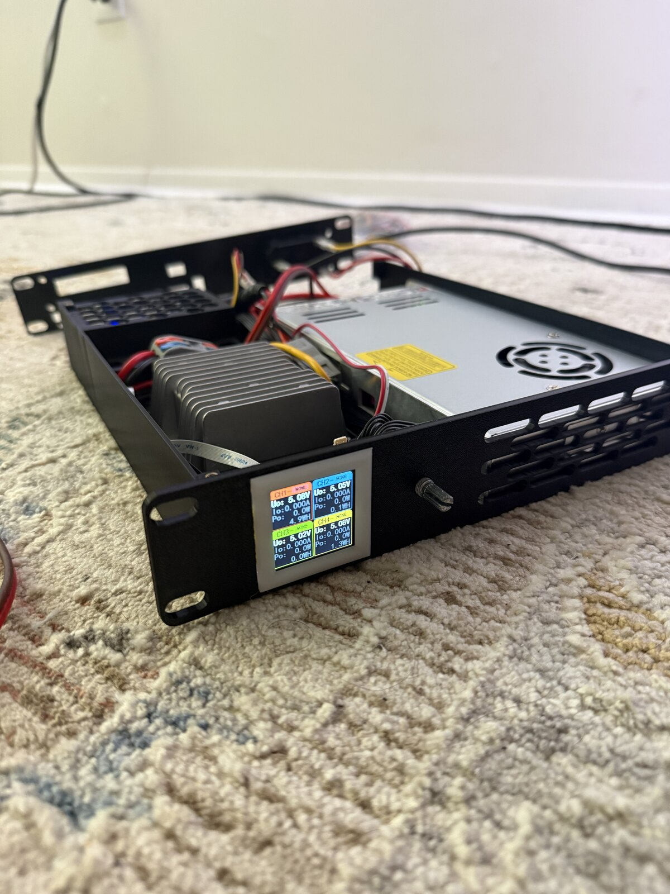
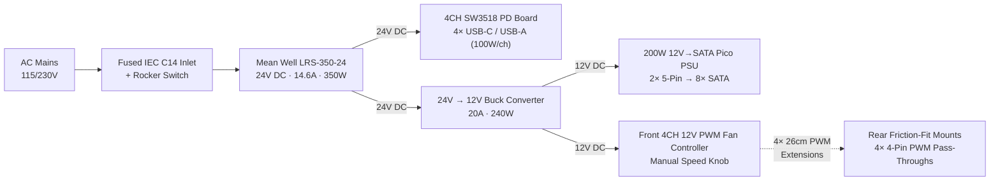
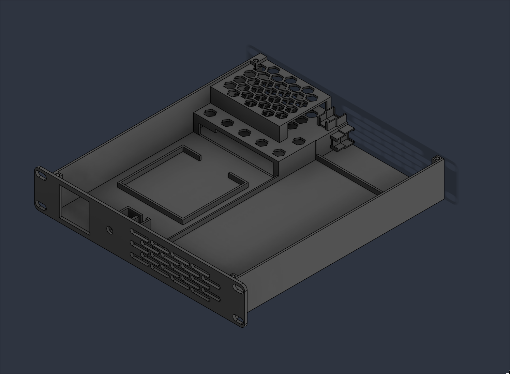
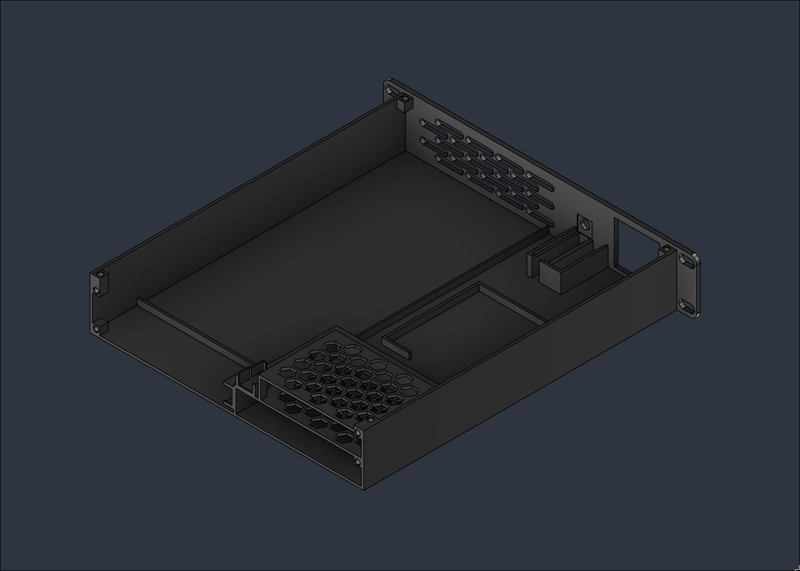
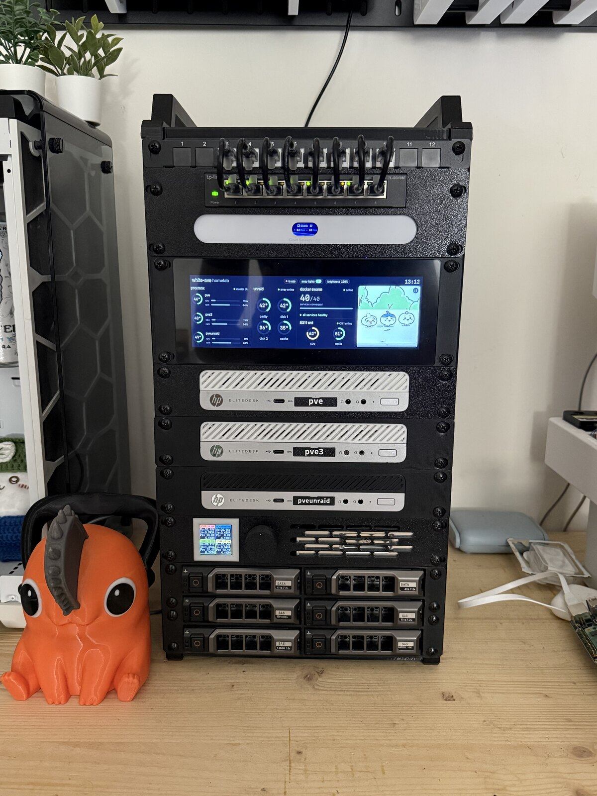
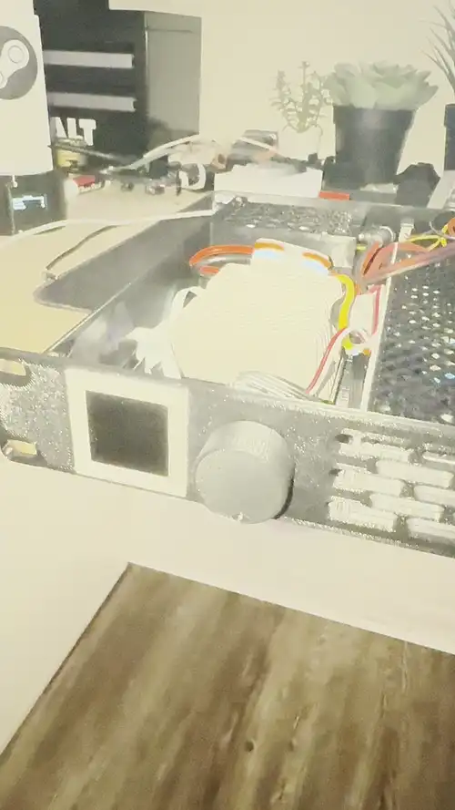
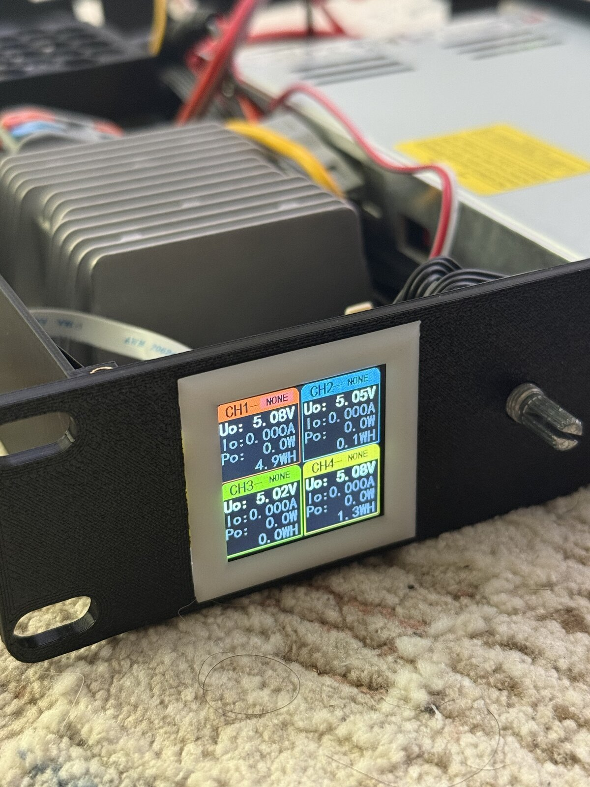
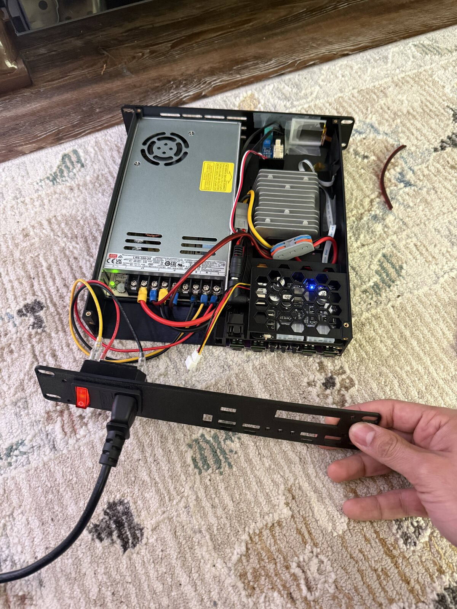
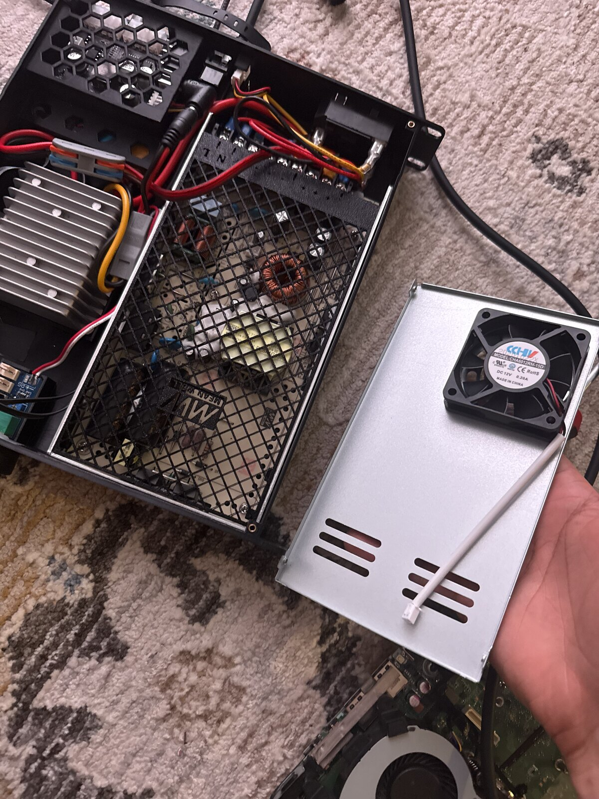

# 10" 1U Mini Rackmount PSU

A custom 3D-printed **10-inch 1U rackmount power supply** built around a **Mean Well LRS-350-24** (350 W / 24 V DC). Designed to consolidate power bricks in a 10" homelab mini-rack into a single unit providing:

- **4× independent fast-charging USB-C / USB-A PD channels** (SW3518, up to 100 W per port) with a front-mounted **1.54" IPS telemetry display**
- **12 V SATA power distribution** for up to **8× 2.5"/3.5" drives** via a 200 W DC-to-SATA Pico PSU (dual 5-pin modular outputs)
- **4-channel 12 V PWM fan controller** with a front-panel manual speed knob for quiet rack cooling

---

## Specifications

| Parameter | Value |
| :--- | :--- |
| **Form Factor** | 10-inch rack, 1U (`254.0 × 44.5 × 257.0 mm`) |
| **AC Input** | 115 / 230 V AC via fused IEC320 C14 inlet with illuminated rocker switch |
| **Primary Rail** | 24 V DC, 14.6 A max (350 W continuous — Mean Well LRS-350-24) |
| **Secondary Rail** | 12 V DC, 20 A max (240 W rated — 24 V → 12 V IP68 buck converter) |
| **USB PD Outputs** | 4× independent SW3518 channels (USB-C + USB-A, PD 3.0 / QC 4.0, up to 100 W/ch) |
| **Storage Power** | 2× 5-pin modular headers → up to 8× SATA power connectors (200 W Pico PSU) |
| **Fan Control** | 4× 4-pin PWM 12 V headers (3 A max total), front-panel manual knob |
| **Enclosure** | 3-piece 3D-printed chassis (`enclosure`, `top-cover`, `backplate`) |

> **Power budget note:** Downstream capacity can reach a max of **600 W+** on paper (**400 W** from the 4-channel SW3518 board + **200 W** from the SATA Pico PSU, plus fans), all sharing the **350 W** output budget of the Mean Well LRS-350-24. For this build, 350 W is plenty for my needs. If you need the full 600 W headroom, Mean Well offers the [LRS-600-24](https://www.meanwell.com/Upload/PDF/LRS-600/LRS-600-SPEC.PDF), though it is larger (`225 × 124 × 41 mm` vs. `215 × 115 × 30 mm` for the LRS-350-24) and will require slight CAD modifications to fit inside a 1U (`44.5 mm`) chassis.

---

## Power Architecture

---

## Bill of Materials (BOM)

| Component | Specs / Notes | Link |
| :--- | :--- | :--- |
| **Mean Well LRS-350-24** | 350 W, 24 V DC / 14.6 A enclosed switching PSU | [Mean Well Datasheet](https://www.meanwell.com/Upload/PDF/LRS-350/LRS-350-SPEC.PDF) · [Product Page](https://www.meanwell.com/webapp/product/search.aspx?prod=LRS-350) |
| **Noctua NF-A6x15 PWM** | 60 × 60 × 15 mm, 12 V, 4-pin PWM slim fan (max 19.8 dB(A)); quiet drop-in replacement for the loud stock LRS-350-24 fan | [Noctua Specs](https://www.noctua.at/en/products/nf-a6x15-pwm/specifications) |
| **400W 4CH SW3518 Fast Charging Module** | 4× SW3518 buck channels (PD 3.0 / QC 4.0), 12–30 V input, 1.54" color IPS display (board harvested from aluminum housing) | [eBay Listing](https://www.ebay.com/itm/388657911500) · [AliExpress Search](https://www.aliexpress.com/w/wholesale-sw3518.html) |
| **24V → 12V 20A Buck Converter** | YIPIN HEXHA DC 18–35 V to 12 V 20 A (240 W), IP68 potted aluminum heatsink, includes lever splice connectors | [Amazon](https://www.amazon.com/dp/B09541C66X) |
| **200W HDD/SSD 12V-to-SATA Pico PSU** | DEBROGLIE 12 V DC input, dual 5-pin modular outputs (each breaks out to 4× SATA) + optional USB power-on sync line | [AliExpress](https://www.aliexpress.com/item/1005006503128543.html) |
| **4-Channel 12V 3A PWM Fan Controller** | 4× 4-pin PWM fan headers (3 A total), rotary speed knob with power switch + start-speed trim pot | [AliExpress](https://www.aliexpress.com/item/1005010140634099.html) |
| **Fused IEC320 C14 Power Inlet** | Panel-mount male C14 socket with illuminated red rocker switch, fuse holder, and pre-wired spade leads | [AliExpress](https://www.aliexpress.com/item/1005008250949486.html) · [Amazon](https://www.amazon.com/clp/B00NWO68JI) |
| **10-Pin 0.5 mm FFC Extension + Coupler** | 10-pin 0.5 mm pitch FFC/FPC ribbon cable + female-to-female adapter board to extend the SW3518 1.54" display to the front panel | [Amazon](https://www.amazon.com/clp/B07RWF2N1B) · [AliExpress](https://www.aliexpress.com/item/33019478636.html) |
| **4-Pin PWM Fan Extension Cables (26 cm)** | 4× 26 cm 4-pin PWM extension cables; plug into the front fan controller and friction-fit into rear chassis mounts for external fan pass-through | [AliExpress](https://www.aliexpress.com/item/1005006878304303.html) |
| **M3 Heat-Set Inserts & Screws** | Brass M3 heat-set threaded inserts + M3 screws; secures both the backplate and top cover to the main chassis | — |
| **Wiring & Connectors** | Lever wire splice connectors (24 V & 12 V distribution), 5.5 × 2.5 mm right-angle DC barrel plug (12 V → Pico PSU) | — |

---

## 3D-Printed Enclosure (CAD & STLs)

Both ready-to-slice **STL** meshes and editable **Fusion 360 (`.f3d`)** source files are included in [`cad/`](cad/).

| Part | Dimensions (W × H × D) | STL | Fusion 360 |
| :--- | :--- | :--- | :--- |
| **Main Enclosure** | `254.0 × 44.5 × 257.0 mm` | [`cad/stl/enclosure.stl`](cad/stl/enclosure.stl) | [`cad/f3d/enclosure.f3d`](cad/f3d/enclosure.f3d) |
| **Top Cover** | `222.0 × 254.0 × 9.0 mm` | [`cad/stl/top-cover.stl`](cad/stl/top-cover.stl) | [`cad/f3d/top-cover.f3d`](cad/f3d/top-cover.f3d) |
| **Backplate** | `254.0 × 44.5 × 10.4 mm` | [`cad/stl/backplate.stl`](cad/stl/backplate.stl) | [`cad/f3d/backplate.f3d`](cad/f3d/backplate.f3d) |

| Front / Interior CAD View | Rear / Backplate CAD View |
| :---: | :---: |
|  |  |

**Printing recommendations:**
- **Material:** PETG, ABS, or ASA (avoid PLA near the LRS-350-24 and 24 V → 12 V buck heatsink).
- **Build plate:** Minimum `255 × 260 mm` bed size for single-piece printing of the main chassis.
- **Assembly hardware:** Install M3 heat-set threaded inserts into the main enclosure bosses — both the backplate and the top cover bolt directly into these inserts with M3 screws for easy serviceability.

---

## Build & Safety Notes

- **Mean Well LRS-350-24 cooling & Noctua fan swap:** The stock 60 × 15 mm fan (`CCHV CHA6012RM-15D`) in the LRS-350-24 is notoriously loud under load. An initial fan-delete using an open 3D-printed grille cover on the Mean Well unit was tested (see gallery), but active cooling was kept instead by swapping in a **Noctua NF-A6x15 PWM** (60 × 60 × 15 mm, 12 V, max 19.8 dB(A)), which runs dramatically quieter than the stock fan. Always keep the top cover installed during operation to prevent accidental contact with high-voltage primary-side components.
- **SW3518 display relocation:** The 4-channel SW3518 PCB is removed from its stock aluminum shell and mounted at the rear so its USB-C/USB-A ports and `K1`–`K3` buttons align with the backplate cutouts. Its 1.54" IPS screen is extended to the front bezel using a 10-pin 0.5 mm pitch FFC cable and a female-to-female coupler board.
- **Rear PWM fan pass-throughs:** The 4-channel PWM fan controller mounts behind the front panel (for the manual speed knob). Four 26 cm 4-pin PWM fan extension cables run from the controller to dedicated friction-fit sockets printed into the rear of the chassis, letting you plug rack fans directly into the back of the PSU.
- **Stacked rear modules:** The 200 W SATA Pico PSU mounts above the SW3518 board in the rear-right bay, exposing both 5-pin SATA breakout headers on the backplate.
- **DC distribution:** The LRS-350-24's dual 24 V output terminals feed both the SW3518 board directly and the 24 V → 12 V 20 A buck converter; compact lever connectors split the 12 V output cleanly to the SATA Pico PSU and 4-channel PWM fan controller.

---

## Gallery

<table>
  <tr>
    <th width="50%">Mounted in 10" Homelab Rack</th>
    <th width="50%">Build Walkthrough</th>
  </tr>
  <tr>
    <td width="50%" align="center"></td>
    <td width="50%" align="center"></td>
  </tr>
</table>

| Live 1.54" Channel Telemetry | Interior Wiring Layout |
| :---: | :---: |
|  |  |

| Early LRS-350-24 Fan-Delete / Open Grille Test *(Later Swapped to Noctua NF-A6x15 PWM)* |
| :---: |
|  |

